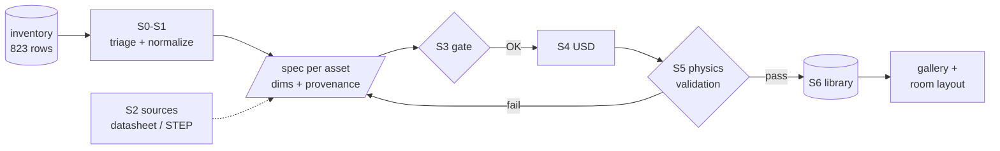

# lab-twin: Poon Lab digital twin, asset pipeline

This pipeline turns the lab inventory (`data/Poon_Lab_Digital_Twin_Inventory_Twin_Assets_.csv`, 823 rows) into
simulation-ready USD assets for Isaac Sim 6.1, then into scenes. It follows the
MATTERIX asset pattern: each asset carries its geometry, physics and **key points**,
and a scene is a config of asset ids and poses.

Every stage runs headless, so it works over plain ssh. The GUI over VNC is only needed for
looking at results.

## Pipeline



Diagrams of the data model, USD asset structure, validation sequence, status
states and deployment are in [`docs/ARCHITECTURE.md`](docs/ARCHITECTURE.md).

| Stage | Script | What it does |
|---|---|---|
| S0 triage | `pipeline/s0_triage.py` | Assigns priority, route and flags, and parses dimensions from each description |
| S1 normalize | `pipeline/s1_normalize.py` | Splits grouped rows, expands packs, assigns scope and family, writes `data/manifest.csv` and spec stubs |
| S2 source | `pipeline/s2_record_source.py` | Registers a downloaded STEP or datasheet with its URL and SHA-256 (vendor sites block scripts) |
| S3 spec | `specs/<id>.json` + `pipeline/s3_check_spec.py` | Fills dimensions with provenance; a machine gate checks completeness, ranges and citations |
| S3a CAD | `pipeline/s3_step_convert.py` | Converts STEP to USD with the Isaac Sim HOOPS converter, headless |
| S4 author | `pipeline/s4_author_usd.py` | Authors USD in metres, Z-up, with collision, physics material, mass, key points and semantics |
| S5 validate | `pipeline/s5_validate.py` | Runs metrics, bbox, floor-origin and collision checks, plus a PhysX drop test on every support surface, with a negative control |
| S6 register | `pipeline/s6_register.py` | Writes `assets/library.json`, which scene builders read |
| scenes | `scenes/build_gallery.py`, `scenes/build_layout.py` | Builds the review gallery with thumbnails, and the room layout from YAML |

```bash
python3 -m venv .venv && .venv/bin/pip install cadquery trimesh numpy jsonschema pyyaml pandas pillow
pipeline/run_batch.sh                  # S3 gate -> S6, gallery, contact sheet, docs/STATUS.md
```

Instructions for each stage (written so a smaller LLM or a new student can do one
stage for one asset) are in [`docs/stage_sheets/`](docs/stage_sheets/README.md).
Current state and the **measurement checklist** are in [`docs/STATUS.md`](docs/STATUS.md).

## Conventions

- **Units:** specs are in mm and USD is in m; only `s4_author_usd.py` converts between them.
- **Asset frame:** the origin is at the footprint centre on the floor, +X is width, +Y is back (the front face is at -Y), +Z is up.
- **Provenance:** every parameter has `src` = inventory | datasheet (with url and quote) | vendor_cad | measured (with by and date) | assumed (with note).
  An asset with any `assumed` dimension validates as `done:provisional`.
- **Never edit generated files** (`assets/`, `data/manifest.csv`, `docs/STATUS.md`). Change the spec and re-run.

## Verified on this machine (RTX PRO 6000, Isaac Sim 6.1.0 standalone, 2026-10-09)

- **Headless STEP→USD:** `kit --enable omni.kit.converter.hoops_core --no-window --exec hoops_main.py ...` works,
  taking about 20 s cold and 2 s warm. The output is in mm and Z-up.
- **Mass from CAD:** for the TR2-like fixture, mass from mesh volume x density is within 0.15 % of the analytic volume.
- **Drop-test validator:** the probe rests within 0.01 mm. With collision disabled (negative control), every probe falls through.
- **Vendor access:** newport.com returns 403 to scripts, and thorlabs.com is a JS app. Sourcing is therefore manual or browser-driven (S2).
