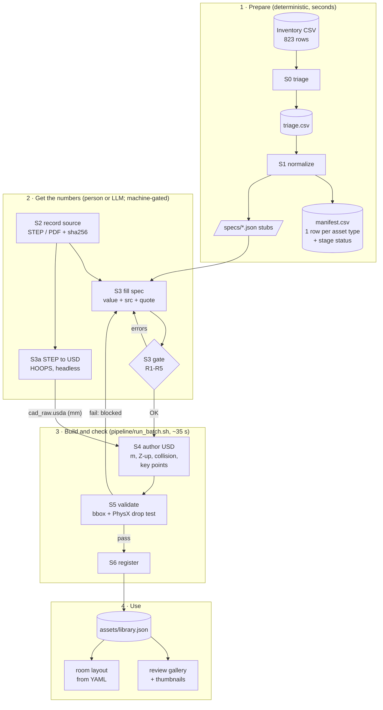
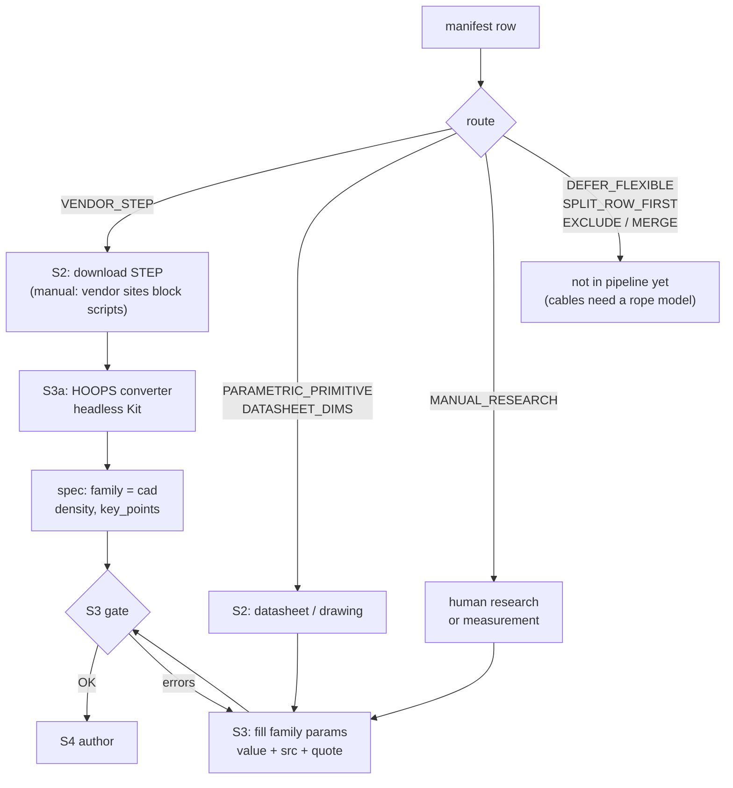
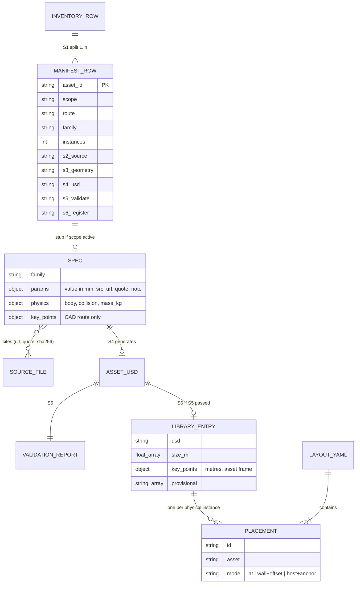
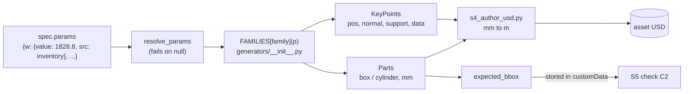
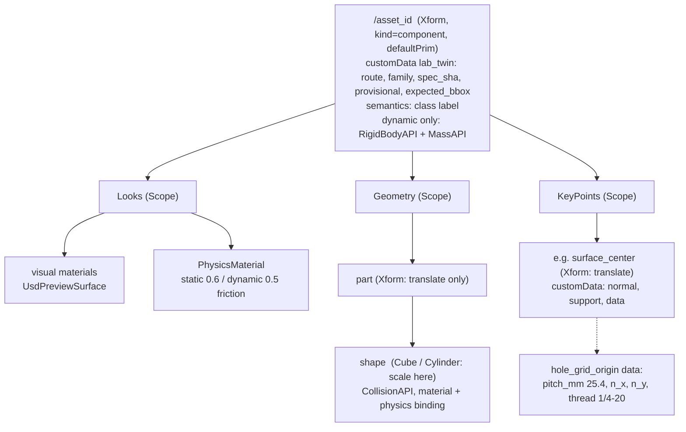
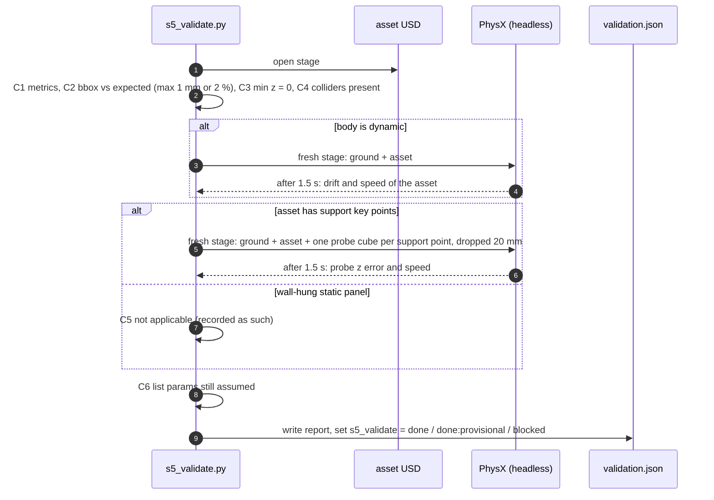
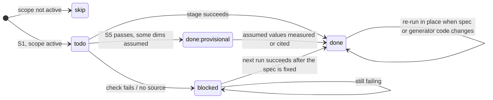
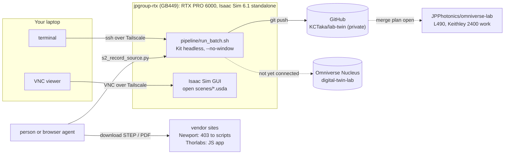
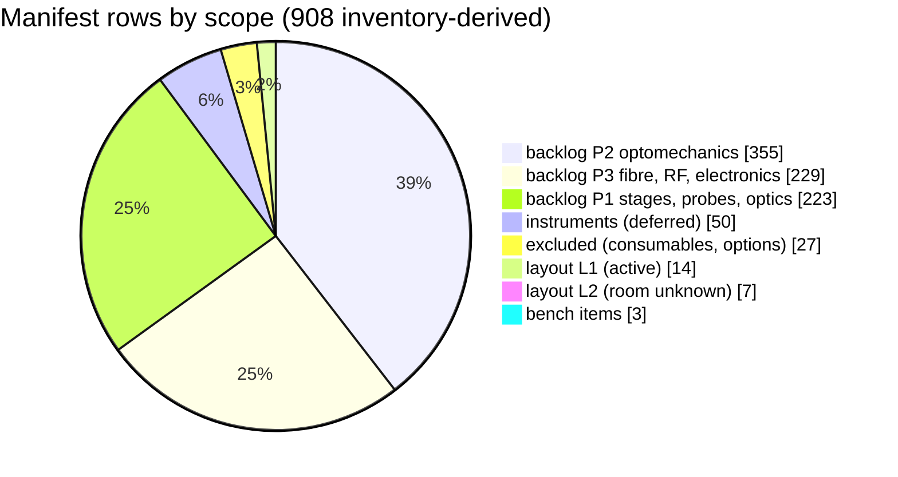

# Architecture

How the pipeline is put together and why. For the per-stage instructions, see
[stage_sheets/](stage_sheets/README.md); for the current state, see [STATUS.md](STATUS.md).

## 1. End-to-end flow

Stages S4 to S6 and the scene builders run in one command (`pipeline/run_batch.sh`),
headless. S2 and S3 are where people or LLMs work; the S3 gate is what keeps
their output honest.

## 2. Routes: which path an asset takes

`route` is set in S0 and can be overridden by an explicit rule in S1. In the
layout pass, the Newport tables were rerouted from `VENDOR_STEP` to parametric
because vendor tabletop CAD carries thousands of tapped holes.

## 3. Data model

One inventory row can become several assets (rows such as `A; B; C` are split).
The spec is the contract: everything downstream is generated from it.

## 4. From spec to USD (parametric route)

Families today: `optical_table`, `workbench`, `shelving_closed`, `wall_panel`,
`projector_screen`, `curtain`, `cart`, `appliance_box`, `overhead_shelf`,
`hanging_shelf`. Adding a family means writing one generator function plus one
`REQUIRED` entry with plausibility ranges.

## 5. What an asset USD contains

Translate on the parent and scale on the child that carries `CollisionAPI`:
the Isaac Sim physics skill reports wrong collision bounds when a collider is scaled
and translated on the same prim. CAD assets differ only under `Geometry`: one
Xform that recentres (footprint centre to origin, lowest point to z = 0) and scales
by the converter's `metersPerUnit` (0.001), referencing `./cad/cad_raw.usda`, with
`CollisionAPI` + `MeshCollisionAPI` on every mesh.

Asset frame for every family: origin at the footprint centre on the floor, +X width,
+Y back (front face at -Y), +Z up.

## 6. Validation (S5)

The probe is 100 mm and 1 kg on static assets. On dynamic assets it is scaled to
the surface (at most half the footprint, at most 20 % of the asset mass), so that it
tests the collider instead of knocking a small part over.
`--negative-control` reruns C5 with the asset's collision disabled: every probe must
then fail, which proves C5 is not vacuous.

## 7. Stage status

Each stage column in `manifest.csv` moves through the same states. A stage picks
up rows whose previous stage is `done` and whose own column is `todo`, `blocked`
or stale; it never resets a column to `todo`. S2 is advisory: the S3 gate checks
provenance inside the spec instead.

S4 detects staleness from `build/id/authored.json` (spec hash and generator-code
hash); S5 re-runs when the USD is newer than its report.

## 8. Where things run

The GPU is shared (other users' Kit sessions run on it); batch runs are short, but
schedule large conversion jobs.

## 9. Inventory coverage (2026-10-09)

Layout L1 is 14 asset types covering 30 physical instances; 13 types are validated,
and the AVJ42 cart is blocked (maker and dimensions unknown).

---

Diagrams are Mermaid (rendered natively by GitHub). After editing any of them, run
`tests/check_mermaid.sh`; it renders every Mermaid block in the repo and fails on a syntax error.
