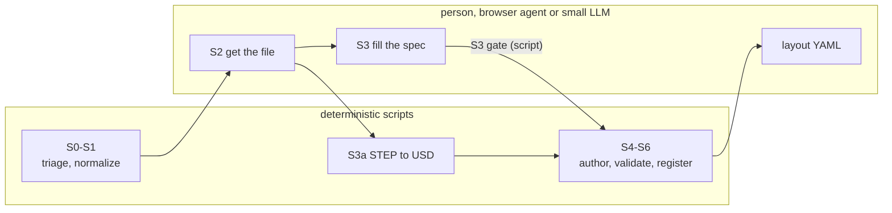

# Stage sheets

One sheet per pipeline stage. Each sheet is self-contained: an agent (or a
student) handling **one asset at one stage** should need nothing else.

| Stage | Sheet | Who does it | Automated? |
|---|---|---|---|
| S0 triage, S1 normalize | [S0_S1_triage_normalize.md](S0_S1_triage_normalize.md) | maintainer | yes, deterministic |
| S2 source | [S2_source.md](S2_source.md) | person or browser agent | no: vendor sites block scripts |
| S3 geometry (spec) | [S3_geometry_spec.md](S3_geometry_spec.md) | small LLM + checker | LLM fills, code checks |
| S3a STEP to USD | [S3a_step_convert.md](S3a_step_convert.md) | script | yes (headless Kit) |
| S4 author, S5 validate, S6 register | [S4_S6_author_validate_register.md](S4_S6_author_validate_register.md) | script | yes |
| Layout scene | moved to the lab-room repo (`docs/LAYOUT.md`, `docs/SCAN.md`) | person + LLM | room scanned 2026-10-09; shell fit next |



Everything a person or LLM produces passes a machine check before it is used:
specs pass the S3 gate, assets pass S5, and layouts are checked for overlaps on build.

## Universal rules (apply to every stage)

1. **Never invent a number.** Every value comes from the inventory, a datasheet
   (URL + verbatim quote), vendor CAD, or a tape measurement (who + date). If none
   exists, use `"src": "assumed"` with a `note` saying why the value is reasonable.
   The asset is then built but stays **provisional** until the value is replaced.
2. **Units: mm in specs, m in USD.** The only place that converts is
   `s4_author_usd.py`. Datasheets in inches: convert with 1 in = 25.4 mm and keep
   the original string in `quote`.
3. **One asset, one stage, one status write.** Read `data/manifest.csv`, work on
   rows whose previous stage is `done`, and write only your own stage column.
4. **Do not edit generated files** (`assets/*/*.usda`, `assets/library.json`,
   `data/manifest.csv` by hand). Change the spec, then re-run the stage.
5. **Stop and escalate** (set status `blocked:<reason>` and tell a human) when the
   sheet says so; never work around a failed check by loosening it.

## Status vocabulary

`todo`, `done`, `done:provisional` (S5 only), `blocked:<reason>`, `skip:<scope>`.

## Where things live

```
data/            inventory, triage.csv, manifest.csv (state machine)
specs/<id>.json  the per-asset contract (dimensions + provenance + physics + key points)
sources/<id>/    vendor files + SOURCE.json (git-ignored; hashes are on record)
build/<id>/      intermediates: converter output, logs, authored.json
assets/<id>/     <id>.usda, cad/ (if CAD), validation.json, thumb.png
assets/library.json   registry the scene builders read
scenes/          gallery (review) and lab layout
```
