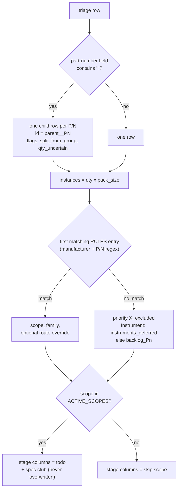

# S0 triage and S1 normalize (deterministic)

```bash
.venv/bin/python pipeline/s0_triage.py data/Poon_Lab_Digital_Twin_Inventory_Twin_Assets_.csv data/triage.csv
.venv/bin/python pipeline/s1_normalize.py
```

- **S0** assigns priority (P0 to P3, X), route (`VENDOR_STEP`,
  `DATASHEET_DIMS`, `PARAMETRIC_PRIMITIVE`, `MANUAL_RESEARCH`,
  `DEFER_FLEXIBLE`, `SPLIT_ROW_FIRST`, `EXCLUDE`, `MERGE_INTO_PARENT`),
  flags, and dimensions parsed from the description, with a `reason` per row.
- **S1** splits rows with several part numbers (`A; B; C`) into child rows,
  computes `instances = qty x pack_size`, assigns `scope` and `family` from the
  explicit rule table `RULES` in `s1_normalize.py`, writes `data/manifest.csv`,
  and creates spec stubs for active scopes. It never overwrites an existing spec
  and keeps stage progress across re-runs.

## What S1 does to one triage row



## Changing scope

To bring more rows into the pipeline, add a rule to `RULES` (manufacturer regex,
part-number regex, scope, family, optional route override, note) and add its
scope to `ACTIVE_SCOPES`. Prefer explicit rules over keyword heuristics: every
assignment should be explainable from one line.

## Current scopes (2026-10-12)

| scope | rows | meaning |
|---|---|---|
| layout_L1 | 14 | furniture and tables that define the lab layout (active) |
| layout_L2_room_tbd | 7 | large process tools (ICP etcher, pumps, chiller): which room? |
| bench_items | 3 | bench-top units placed on furniture later |
| instruments_deferred | 50 | instruments: later doc-to-asset pipeline |
| cad_ingested | 10 | vendor STEP downloaded (CAD pilot), routed to the CAD path (active) |
| backlog_P1..P3 | 797 | stages, probes, optomechanics, fibre, etc. |
| excluded | 27 | consumables, options, kit parents |
| pipeline_test | 3 | synthetic STEP fixtures for the CAD route; validated, not registered |
