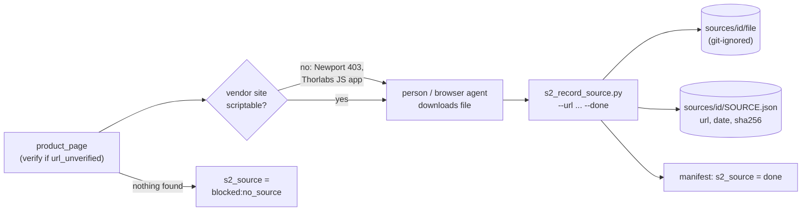

# S2 - Obtain and record a source document

**Goal:** every number in a spec traces back to a file on record. This stage gets
the file (vendor STEP, datasheet PDF, drawing, photo) and records where it came
from.

## Why this is manual

Tested 2026-10-09 from the lab machine:

- `newport.com` returns **HTTP 403** to scripted requests (bot protection).
- `thorlabs.com` is a JavaScript single-page app; `curl` gets an empty shell, so
  neither link verification nor CAD download can be scripted with plain HTTP.
- `harvardapparatus.com` responds normally.

So a person (or a browser-driving agent) downloads the file, then runs one
command to register it.



## Steps

1. Pick a row with `s2_source = todo`. Open its `product_page`. If the
   `flags` column contains `url_unverified` (link was constructed from the part
   number), confirm the page really is this part number before trusting it.
2. Download what the route needs:
   - `VENDOR_STEP`: the STEP (`.step`/`.stp`) file. Prefer the single-part
     file over an assembly with fasteners. Thorlabs: "CAD" tab on the item page.
     Newport: "CAD/Drawings" on the product page (may need login).
   - `PARAMETRIC_PRIMITIVE` / `DATASHEET_DIMS`: the datasheet or dimensional
     drawing (PDF). A product page screenshot is acceptable only if no PDF exists.
3. Register it:
   ```bash
   .venv/bin/python pipeline/s2_record_source.py <asset_id> ~/Downloads/<file> \
       --url "<page you downloaded it from>" --done
   ```
   For lab measurements: write them in a text file, `--kind measurement --url n/a`.
4. If no source exists after a reasonable search, set
   `s2_source = blocked:no_source` and add what you tried to `notes`.

## Do not

- commit anything under `sources/` (vendor licences); the hash in
  `SOURCE.json` is the record;
- rename vendor files: the original name often encodes revision information.
