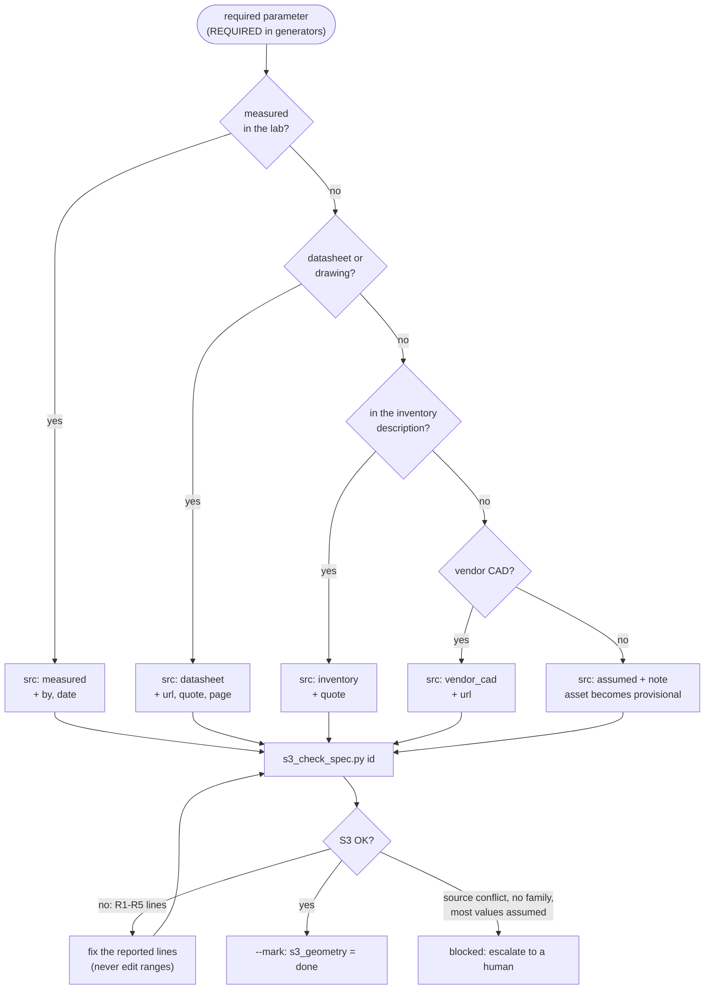

# S3 - Fill a geometry spec

**Goal:** make `specs/<asset_id>.json` complete, plausible and sourced, so that
`pipeline/s3_check_spec.py <asset_id>` prints `S3 OK`.

**You need:** the asset row in `data/manifest.csv`, its spec stub, and any
documents recorded in `sources/<asset_id>/SOURCE.json` (see S2).

**You must not:** write USD, edit generator code, or change ranges in
`pipeline/generators/__init__.py` to make a check pass.

## Where each number comes from



## Steps

1. Open the spec. Read `family`. If `family` is empty, **stop**: set
   `s3_geometry` to `blocked:no_family` and escalate. A human picks the family.
2. Look up the required parameters for that family in `REQUIRED` in
   `pipeline/generators/__init__.py`. The docstring of the family function
   explains what each one means geometrically (see the frame convention at the top
   of that file: origin at the footprint centre on the floor, +Y back, +Z up).
3. For each required parameter, find a value in this order of preference:
   1. `measured`: a tape measurement in the lab (`by`, `date` required)
   2. `datasheet`: the vendor datasheet or drawing (`url`, `quote` required, plus `page` if a PDF)
   3. `inventory`: parsed from the inventory description (`quote` = the phrase)
   4. `vendor_cad`: read from vendor CAD (`url` of the CAD file)
   5. `assumed`: last resort, with a `note` naming the basis (e.g. "typical
      for this product class; related model X is 25 mm")
4. Write the parameter as:
   ```json
   "top_t": {"value": 25.4, "unit": "mm", "src": "datasheet",
             "url": "https://.../WS08.pdf", "page": 3, "quote": "Top thickness 1\""}
   ```
   `value` is always in mm. `quote` is copied verbatim from the source and must
   contain the number.
5. Physics block:
   - Furniture, tables and anything bolted or too heavy to push: `"body": "static"`.
   - Things a robot or person moves (carts, posts, mounts): `"body": "dynamic"`
     plus `mass_kg` with a source.
   - `collision`: `box` for parametric families (the parts are boxes already).
6. Run the checker and fix every reported line:
   ```bash
   .venv/bin/python pipeline/s3_check_spec.py <asset_id>
   ```
7. When it prints `S3 OK`, mark it:
   ```bash
   .venv/bin/python pipeline/s3_check_spec.py <asset_id> --mark
   ```

## Reading the checker

| Message | Meaning | Fix |
|---|---|---|
| `R1 missing param X` | required value absent or null | find it (step 3) |
| `R2 X=... outside plausible range` | almost always a unit error | check in vs mm vs m; never edit ranges |
| `R3 X: datasheet source without quote` | provenance incomplete | add the verbatim quote |
| `R3 X: assumed value needs a note` | unexplained guess | add `note`, or find a source |
| `R4 generator failed` | parameters inconsistent (e.g. pedestal wider than half the bench) | re-read the source; escalate if the source itself is inconsistent |

## Escalate (status `blocked:<reason>`) when

- the datasheet describes a different model than the part number, or the
  description contradicts the datasheet (e.g. inventory says 100 x 84 in, vendor
  stock size is 58 x 96 in);
- the object does not fit any family (e.g. has doors that matter, is L-shaped);
- more than half the required parameters would be `assumed`.

## Worked example (workbench, from the pilot)

Inventory: "Rousseau modular workbench 72 in W x 24 in D x 33.75 in H; ...
2x LA85-182104 4 in bases". `w`, `d`, `h` come from the inventory and `base_h`
= 101.6 mm (`"quote": "2x LA85-182104 4 in bases"`). `top_t`, `ped_w`, `ped_d`
were not in the inventory, so they are `assumed` until the Rousseau
WS08-7224A / L3ABD-2852 drawings are found. The checker reports the asset
`OK ... provisional: ['top_t', 'ped_w', 'ped_d', 'physics.mass_kg']`.
