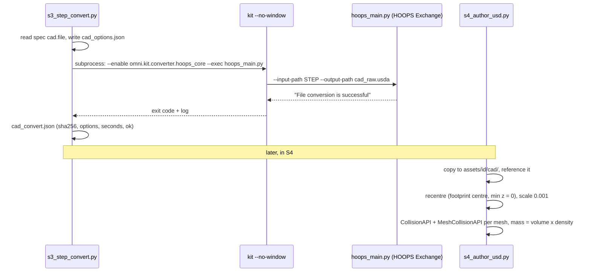

# S3a - Convert vendor STEP to raw USD (headless)

**Goal:** `build/<asset_id>/cad_raw.usda` from the STEP file recorded in S2.

## Preconditions

- `s2_source = done` and `sources/<asset_id>/SOURCE.json` lists a `step` file.
- The spec has `"family": "cad"` and
  `"cad": {"file": "sources/<asset_id>/<file>.step", "units": "mm"}`.
- The spec's physics block has `density_kg_m3` (stage 4 computes mass = mesh
  volume x density), or an explicit `mass_kg` from the datasheet. Reference
  densities: aluminium 6061 2700, stainless 303/304 7930, steel 7850, brass 8500.
- The spec lists `key_points` in **mm, in the CAD file's own frame after
  recentering** (footprint centre at origin, lowest point at z = 0).

## Run

```bash
.venv/bin/python pipeline/s3_step_convert.py <asset_id>
```

This launches Isaac Sim's Kit with `--no-window` and the HOOPS converter
(`omni.kit.converter.hoops_core`), so it works over plain ssh. A cold start takes
about 20 s and a warm one about 2 s per file.



After a successful conversion, S3a also reads the STEP with OpenCASCADE
(`pipeline/cad_analyze.py`, independent of the converter) and writes
`build/<id>/cad_analysis.json`:

- **ground-truth bbox**: S5 check C2 compares the authored USD against it, which catches unit
  and axis-permutation errors that a self-referential check would miss;
- **exact B-rep volume**: mass = volume x density (the mesh volume is kept as a
  cross-check; on the fixtures they agree within 0.2 %);
- **automatic key points**: `mount_hole_k` and `top_hole_k` (with a thread guess from
  the modelled diameter), `optical_axis` (the largest horizontal through-bore) and
  `top_surface` (a point on the top face, drop-tested in S5). Each carries
  `data.auto = true`; key points given in the spec override them.

S4 then picks collision per mesh from measured convexity (mesh volume / convex-hull
volume): `convexHull` at 0.80 or above, otherwise `convexDecomposition`. For example,
the post scored 0.97 and the post holder 0.59.

Regression test for the analyser: `.venv/bin/python tests/test_cad_analyze.py`
(synthetic parts with known features from `tests/make_cad_fixtures.py`).

## Check

`build/<asset_id>/cad_convert.json` must have `"ok": true`. Known converter
behaviour (verified on Isaac Sim 6.1.0):

- output is in **millimetres** (`metersPerUnit = 0.001`), Z-up; stage 4 rescales;
- `instancingStyle: 0` is set so every mesh can receive a `CollisionAPI`;
- `convertPhysicsData` produced no attributes for an OpenCASCADE-exported STEP,
  so mass comes from mesh volume x density instead.

## Escalate when

- `ok` is false: attach `build/<id>/cad_convert.log` (search for `error`);
- the STEP is an assembly with hundreds of fasteners: ask a human whether to
  use a simplified CAD download or the parametric route.
