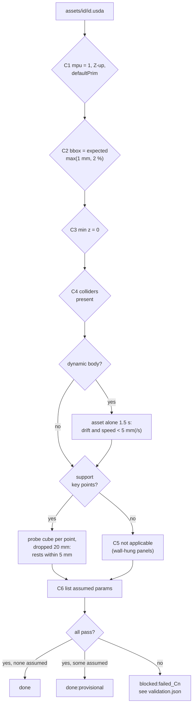

# S4-S6 - Author, validate, register (automated)

These run as one batch, headless (works over ssh):

```bash
pipeline/run_batch.sh               # every row that is ready (or stale)
pipeline/run_batch.sh <asset_id>    # one asset
```

S4 re-runs automatically when a spec changes (spec hash differs from
`build/<id>/authored.json`), and S5 re-runs when the USD is newer than its
validation report.



Any failing C1-C4 check also ends in `blocked`; the chart shows the order in which
checks run, not early exits.

## What S5 checks (assets/<id>/validation.json)

| Check | Pass condition | Usual cause of failure |
|---|---|---|
| C1 metrics | metersPerUnit 1, Z-up, defaultPrim `/<id>` | hand-edited USD |
| C2 bbox | USD bbox equals spec/generator bbox within max(1 mm, 2 %) per axis | generator bug; for CAD: wrong units in the STEP |
| C3 floor origin | lowest point at z = 0 within 1 mm | CAD recentering failed |
| C4 collision | at least one collidable shape | `collide` false everywhere |
| C5 physics settle | probe cube dropped 20 mm onto each upward key point rests on it (< 5 mm error, < 5 mm/s); dynamic assets also stay put | missing or disabled collision; key point not on a surface |
| C6 provenance | always passes; lists `assumed` params | n/a (informational) |

C5 is checked against a **negative control**: with the asset's collision
disabled, every probe must fail.

```bash
~/isaacsim/python.sh pipeline/s5_validate.py --negative-control <asset_id>
```

Run it whenever a family or the validator changes.

## Reading results

- `done`: usable.
- `done:provisional`: geometrically sound, but some dimensions are `assumed`.
  Usable for layout; replace the assumptions (S3) before trusting clearances.
- `blocked:failed_C2...`: open `validation.json`, compare `expected_mm` with
  `got_mm`. A factor of 25.4 or 1000 means a unit error in the spec.
- Then look at `assets/<id>/thumb.png`. Every check can pass while the shape is
  still wrong (e.g. pedestals on the wrong side), so a human glance at the
  thumbnail is part of acceptance.

## S6 output

`assets/library.json`: one entry per validated asset, with the USD path, size (m),
key points (m, asset frame), body type, mass and provisional list. Scene
builders read only this file. Self-test fixtures (`FIXTURE_*`, scope `pipeline_test`)
are validated but never registered (`s6_register = skip:pipeline_test`).
